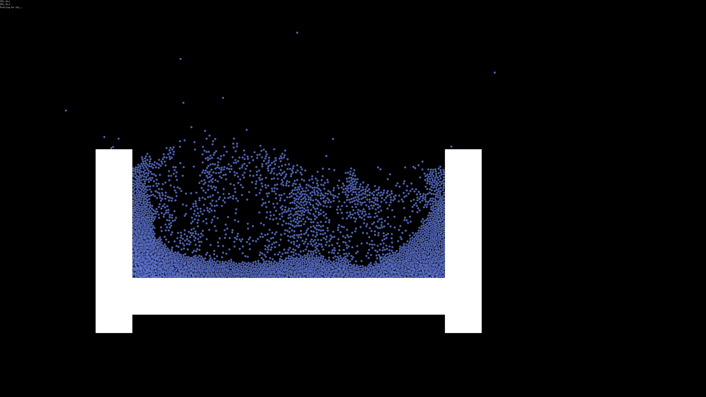

# sim

A 2D rigid-body physics simulation in Go, built from scratch on [Ebitengine](https://ebitengine.org). It drops a few thousand balls into a box and lets them pile up, bounce, and slide around. Looks kinda like liquid in a container.

## Running it

    go run .
    go run . <seed>

It run fullscreen and prints the seed it used, so if something weird happens
you can replay it. Press escape to quit at any time.

## How it works

- **`world/`**: a small ECS. Components live in generic sparse sets and you query them with `Query2`/`Query3`/`Query4` (Go doesn't support variadic generics).
- **`systems/`**: the physics. The current solver is XPBD with substeps, which handles contacts, bounce, and friction. The older Euler/Verlet integrators and impulse resolver came first are still around. They were written first and its educational to compare their behavior to XPDB if you're unfamiliar with the difference.
- **`collision/`** and **`geo/`**: a BVH for the broad phase, then GJK + EPA for the actual contacts. Colliders are just support functions, so circles and boxes go through the same path.
- **`physics/`**: materials (restitution, friction presets from ice to rubber) and rigid bodies. A mass of 0 should be static.
- **`scene/`**: batched quads, a Kage shader, and a camera. Note the shader is absolutely a hack since it uses UV coordinates to indicate the type of shape.

## Profiling

Profiling is on by default. I found it very helpful in eliminating the first several bottlenecks and getting to 4k balls. The first 10 seconds of every run get written to `cpu.prof` and `mem.prof`:

    go tool pprof -http=: cpu.prof

Flip `enabled` in `DefaultProfilingConfig` (`game.go`) to turn it off.

## Status

Works basically. Its just a playground for having fun and learning.
